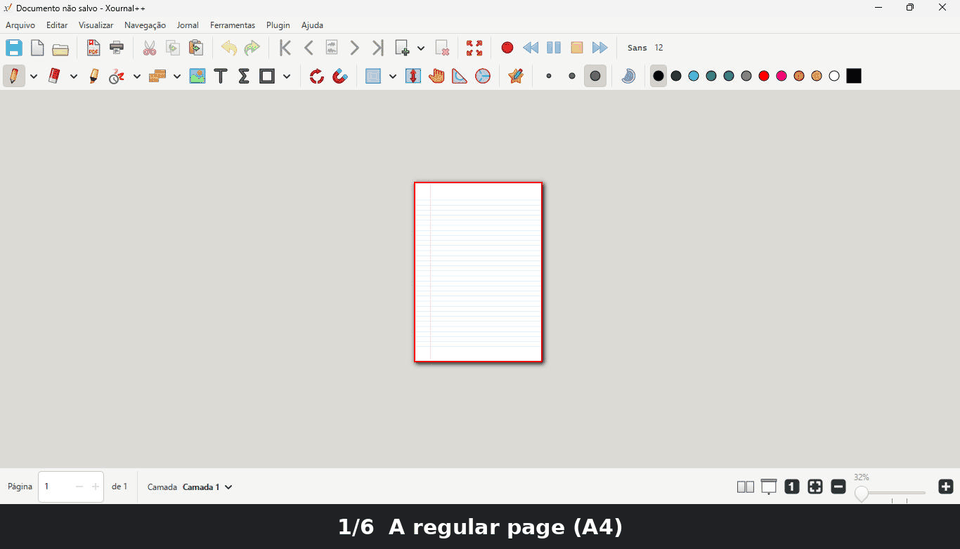

# Infinite Canvas for Xournal++

A [Xournal++](https://github.com/xournalpp/xournalpp) plugin that turns a page into a **dotted canvas that grows as you write**. When your handwriting gets close to the right or bottom edge, the page enlarges itself as soon as you lift the pen. You don't have to resize anything or start with a giant page.

## Why another "infinite" plugin?

Earlier plugins such as [Xournalpp-Infinity-Notes](https://github.com/Robin-Sch/Xournalpp-Infinity-Notes) create one **huge fixed page**. That works, but exports end up with big empty borders and large pages are heavy to render. This plugin takes the opposite approach:

- **Starts small, grows on demand** to the right and downwards, in steps.
- **Grows automatically.** When you lift the pen near an edge, the page grows by itself. There's nothing to click.
- **Fit page to content** trims the empty space before you export.
- **Keeps your zoom.** Your handwriting doesn't shrink every time the page gets wider.
- **Works on the stable release.** Tested on Xournal++ 1.3.4; no nightly build needed.

For PDF annotation with adjustable margins, see also [IncreaseAndDecreasePageDimensions](https://github.com/MiltonBalaOfficial/IncreaseAndDecreasePageDimensions).

## Installation

1. Download this repository (green **Code** button → *Download ZIP*) and extract it.
2. Copy the `InfiniteCanvas` folder into the `plugins` folder inside your Xournal++ config folder (create `plugins` if it doesn't exist):
   - **Windows:** `C:\Users\<user>\AppData\Local\xournalpp\plugins\`
   - **Linux:** `~/.config/xournalpp/plugins/`
   - **macOS:** `~/.config/xournalpp/plugins/`
3. Restart Xournal++. The plugin is enabled by default (check *Plugin → Plugin Manager*).

## Usage

| Shortcut | Action |
|---|---|
| <kbd>Ctrl</kbd>+<kbd>Shift</kbd>+<kbd>N</kbd> | Turn the current page into a dotted canvas |
| <kbd>Ctrl</kbd>+<kbd>Shift</kbd>+<kbd>B</kbd> | Expand downwards now |
| <kbd>Ctrl</kbd>+<kbd>Shift</kbd>+<kbd>M</kbd> | Expand to the right now ("more width") |
| <kbd>Ctrl</kbd>+<kbd>Shift</kbd>+<kbd>J</kbd> | Fit the page to its content (handy before exporting) |
| <kbd>Ctrl</kbd>+<kbd>Shift</kbd>+<kbd>U</kbd> | Toggle auto-grow |

All actions are also in the **Plugin** menu. Toolbar buttons are available in the toolbar customization dialog as `INFINITE_CANVAS_MAKE`, `INFINITE_CANVAS_DOWN` and `INFINITE_CANVAS_RIGHT`.

Auto-grow only acts on **dotted** pages, so your regular pages are never resized. The interface is in English, or in Portuguese when your system language is Portuguese.

## Configuration

Edit the `CONFIG` table at the top of `InfiniteCanvas/main.lua`:

| Option | Default | Meaning |
|---|---|---|
| `initialWidth`, `initialHeight` | `1200`, `1600` | Canvas size when a page is converted (pt) |
| `edgeMargin` | `200` | Grow when content gets closer than this to an edge (pt) |
| `growStep` | `800` | How much the page grows each time (pt) |
| `fitPadding` | `300` | Padding kept by *fit page to content* (pt) |
| `keepZoom` | `true` | Keep the zoom when the width grows (switches *Zoom → Fit* off) |
| `autoGrowPdfPages` | `false` | Experimental: also auto-grow pages that have a PDF background |
| `language` | `"auto"` | `"auto"`, `"en"` or `"pt"` |
| `debugLog` | `false` | Write `debug.log` next to the plugin |

## Limitations

- **Grows only to the right and downwards.** The Lua API can't move existing strokes, so growing up or left would mean shifting all your content.
- **Each growth is an undo step.** <kbd>Ctrl</kbd>+<kbd>Z</kbd> first undoes the growth, then the stroke.
- **PDF pages are not converted**, because that would replace the PDF background. The manual expand actions (<kbd>Ctrl</kbd>+<kbd>Shift</kbd>+<kbd>M</kbd> / <kbd>B</kbd>) still add space beside or below a PDF without stretching it. The new area isn't painted, but you can write on it.
- **Auto-grow checks the current layer**, which is the one you are writing on.
- Tested on **Windows 11 + Xournal++ 1.3.4**. Linux and macOS should work wherever LuaGObject (bundled with Xournal++ 1.3) or `lgi` is available. Reports are welcome!

## How it works

The Xournal++ Lua API has no events (such as "stroke finished") and no timers. The plugin loads **LuaGObject**, the lgi fork bundled with Xournal++ 1.3, and attaches a `GtkGestureDrag` in the **capture phase** to the main window. The gesture never claims the event sequence, so Xournal++ still receives every pen event normally.

On pen-up, about 120 ms later, the plugin reads the current layer with `app.getStrokes`, `getImages` and `getTexts` and grows the page with `app.setPageSize` if the content is within `edgeMargin` of an edge. A slow safety-net check covers tablet drivers that might not report the release. Without LuaGObject the plugin falls back to the manual shortcuts.

A few notes for plugin authors, learned along the way:

- Shortcuts use <kbd>Ctrl</kbd>+<kbd>Shift</kbd> on purpose. On Windows <kbd>Ctrl</kbd>+<kbd>Alt</kbd> acts as AltGr, and on layouts like Brazilian ABNT2 <kbd>AltGr</kbd>+<kbd>C</kbd>/<kbd>E</kbd> type characters, so <kbd>Ctrl</kbd>+<kbd>Alt</kbd>+<kbd>C</kbd> accelerators never fire.
- On Windows the plugin's working directory is `C:\Windows\System32`, so files must be opened with absolute paths (the plugin folder can be found via `debug.getinfo`).
- In 1.3.x, `app.getStrokes` accepts only `"selection"` and `"layer"`.

## License

[MIT](LICENSE) © 2026 Jean Carlos

---

## Português

Plugin para o Xournal++ que transforma a página num **canvas pontilhado que cresce conforme você escreve**. Quando a escrita chega perto da borda direita ou de baixo, a página aumenta sozinha assim que você levanta a caneta.

**Instalação:** copie a pasta `InfiniteCanvas` para `C:\Users\<usuário>\AppData\Local\xournalpp\plugins\` (Windows) ou `~/.config/xournalpp/plugins/` (Linux/macOS) e reinicie o Xournal++.

**Atalhos:** <kbd>Ctrl</kbd>+<kbd>Shift</kbd>+<kbd>N</kbd> transforma a página em canvas; <kbd>B</kbd> expande para baixo; <kbd>M</kbd> expande para a direita; <kbd>J</kbd> ajusta a página ao conteúdo; <kbd>U</kbd> liga ou desliga o crescimento automático (todos com <kbd>Ctrl</kbd>+<kbd>Shift</kbd>). A interface aparece em português automaticamente quando o sistema está em português.
