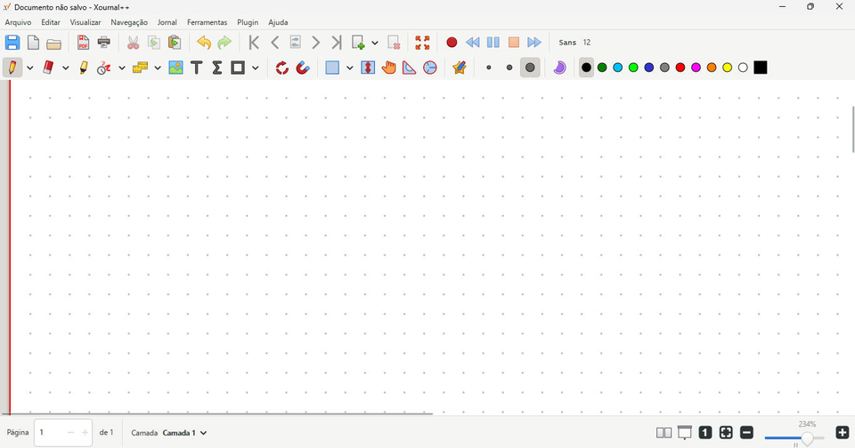

# Infinite Canvas for Xournal++

A [Xournal++](https://github.com/xournalpp/xournalpp) plugin that turns a page into a **dotted canvas that grows as you write**. When your handwriting gets close to the right or bottom edge, the page enlarges itself as soon as you lift the pen. You don't have to resize anything or start with a giant page.

## Why another "infinite" plugin?

Earlier plugins such as [Xournalpp-Infinity-Notes](https://github.com/Robin-Sch/Xournalpp-Infinity-Notes) create one **huge fixed page**. That works, but exports end up with big empty borders and large pages are heavy to render. This plugin takes the opposite approach:

- **Starts small, grows on demand** to the right and downwards, in steps.
- **Grows automatically.** When you lift the pen near an edge, the page grows by itself. There's nothing to click.
- **Fit page to content** trims the empty space before you export.
- **Keeps your zoom.** Your handwriting doesn't shrink every time the page gets wider.
- **Works on the stable release.** Tested on Xournal++ 1.3.4; no nightly build needed.

For PDF annotation with adjustable margins, see also [IncreaseAndDecreasePageDimensions](https://github.com/MiltonBalaOfficial/IncreaseAndDecreasePageDimensions).

## Installation

1. Download this repository (green **Code** button → *Download ZIP*) and extract it.
2. Copy the `InfiniteCanvas` folder into the `plugins` folder inside your Xournal++ config folder (create `plugins` if it doesn't exist):
   - **Windows:** `C:\Users\<user>\AppData\Local\xournalpp\plugins\`
   - **Linux:** `~/.config/xournalpp/plugins/`
   - **macOS:** `~/.config/xournalpp/plugins/`
3. Restart Xournal++. The plugin is enabled by default (check *Plugin → Plugin Manager*).

## Usage

| Shortcut | Action |
|---|---|
| <kbd>Ctrl</kbd>+<kbd>Shift</kbd>+<kbd>N</kbd> | Plain page: turn it into a dotted canvas. Lined, graph or other paper: mark it to grow by itself (press again to unmark) |
| <kbd>Ctrl</kbd>+<kbd>Shift</kbd>+<kbd>B</kbd> | Expand downwards now |
| <kbd>Ctrl</kbd>+<kbd>Shift</kbd>+<kbd>M</kbd> | Expand to the right now ("more width") |
| <kbd>Ctrl</kbd>+<kbd>Shift</kbd>+<kbd>J</kbd> | Fit the page to its content (handy before exporting) |
| <kbd>Ctrl</kbd>+<kbd>Shift</kbd>+<kbd>U</kbd> | Toggle auto-grow |

All actions are also in the **Plugin** menu. Toolbar buttons are available in the toolbar customization dialog as `INFINITE_CANVAS_MAKE`, `INFINITE_CANVAS_DOWN` and `INFINITE_CANVAS_RIGHT`.

Auto-grow acts on **dotted** pages and on paper pages you marked with <kbd>Ctrl</kbd>+<kbd>Shift</kbd>+<kbd>N</kbd>; every other page behaves like a normal notebook page. The interface is in English, or in Portuguese when your system language is Portuguese.

### Lined and other paper pages

Marking a lined (or graph, staves...) page keeps its paper exactly as it is: lines, margin and size. The mark is stored in the page's background settings and saved in the `.xopp` file, so the page keeps growing after you reopen the file. A marked paper page grows in paper-like steps:

- **Downwards** only when you **start writing in the bottom margin, below the last line**. Writing on the last line, including letters that hang below it (like *g* or *ç*), does not make it grow. It grows by 10 lines and always ends on a whole line followed by the paper's footer.
- **To the right** only when a stroke (almost) touches the right edge, by 200 pt.
- Writing that was already on the page when you marked it never makes it grow.

### Fit page to content

<kbd>Ctrl</kbd>+<kbd>Shift</kbd>+<kbd>J</kbd> shrinks (or grows) the page around what is written on it:

- **Height:** ends 40 pt below the last stroke. On lined/ruled paper it ends one free line below the last stroke, followed by the full footer, instead of cutting through it.
- **Width on a dotted canvas:** trimmed to the content.
- **Width on paper pages:** kept at the paper width. If the page was stretched, it goes back to its original width, or to the smallest paper width (other pages of the document, your page template in both orientations, or A5/A4/A3/Letter/Legal/Tabloid) that holds the content. A page whose content already fits is never widened.

## Configuration

Edit the `CONFIG` table at the top of `InfiniteCanvas/main.lua`:

| Option | Default | Meaning |
|---|---|---|
| `initialWidth`, `initialHeight` | `1200`, `1600` | Canvas size when a page is converted (pt) |
| `edgeMargin` | `200` | Dotted canvas: grow when content gets closer than this to an edge (pt) |
| `growStep` | `800` | Dotted canvas: how much the page grows each time (pt) |
| `paperEdgeMargin` | `8` | Marked paper page: grow to the right when a stroke gets this close to the edge (pt) |
| `paperGrowX` | `200` | Marked paper page: how much it grows to the right (pt) |
| `paperGrowLines` | `10` | Marked lined/ruled page: how many lines it grows downwards |
| `paperGrowY` | `240` | Marked graph/other paper page: how much it grows downwards (pt) |
| `fitPadding` | `40` | Space kept below/right of the last stroke by *fit page to content* (pt) |
| `minWidth`, `minHeight` | `300`, `200` | Smallest size *fit page to content* produces (pt) |
| `autoGrowDotted` | `true` | Dotted pages always auto-grow (set `false` to require the mark) |
| `keepZoom` | `true` | Keep the zoom when the width grows (switches *Zoom → Fit* off) |
| `autoGrowPdfPages` | `false` | Experimental: also auto-grow pages that have a PDF background |
| `language` | `"auto"` | `"auto"`, `"en"` or `"pt"` |
| `debugLog` | `false` | Write `debug.log` next to the plugin |

## Limitations

- **Grows only to the right and downwards.** The Lua API can't move existing strokes, so growing up or left would mean shifting all your content.
- **Each growth is an undo step.** <kbd>Ctrl</kbd>+<kbd>Z</kbd> first undoes the growth, then the stroke.
- **PDF pages are not converted**, because that would replace the PDF background. The manual expand actions (<kbd>Ctrl</kbd>+<kbd>Shift</kbd>+<kbd>M</kbd> / <kbd>B</kbd>) still add space beside or below a PDF without stretching it. The new area isn't painted, but you can write on it.
- **Auto-grow checks the current layer**, which is the one you are writing on.
- **"Already written" is remembered per session.** After reopening a file, the first stroke on a marked paper page is treated as new, so if it touches the edge the page may grow one step.
- Tested on **Windows 11 + Xournal++ 1.3.4**. Linux and macOS should work wherever LuaGObject (bundled with Xournal++ 1.3) or `lgi` is available. Reports are welcome!

## How it works

The Xournal++ Lua API has no events (such as "stroke finished") and no timers. The plugin loads **LuaGObject**, the lgi fork bundled with Xournal++ 1.3, and attaches a `GtkGestureDrag` in the **capture phase** to the main window. The gesture never claims the event sequence, so Xournal++ still receives every pen event normally.

On pen-up, about 120 ms later, the plugin reads the current layer with `app.getStrokes`, `getImages` and `getTexts` and grows the page with `app.setPageSize` if the content is within `edgeMargin` of an edge. On marked paper pages it only looks at the strokes written since its last check; on ruled paper it compares each new stroke's vertical centre with the last line, which tells descenders on the last line apart from writing in the bottom margin.

Paper pages are marked by adding `icanvas=1` to the page's background config through `app.changeCurrentPageBackground(format, config)`. Xournal++ saves this config in the `.xopp` file and ignores keys it doesn't know, so the paper is drawn exactly as before. A slow safety-net check covers tablet drivers that might not report the release. Without LuaGObject the plugin falls back to the manual shortcuts.

A few notes for plugin authors, learned along the way:

- Shortcuts use <kbd>Ctrl</kbd>+<kbd>Shift</kbd> on purpose. On Windows <kbd>Ctrl</kbd>+<kbd>Alt</kbd> acts as AltGr, and on layouts like Brazilian ABNT2 <kbd>AltGr</kbd>+<kbd>C</kbd>/<kbd>E</kbd> type characters, so <kbd>Ctrl</kbd>+<kbd>Alt</kbd>+<kbd>C</kbd> accelerators never fire.
- On Windows the plugin's working directory is `C:\Windows\System32`, so files must be opened with absolute paths (the plugin folder can be found via `debug.getinfo`).
- In 1.3.x, `app.getStrokes` accepts only `"selection"` and `"layer"`.
- Ruled/lined paper in 1.3 draws its lines at `80 + i × spacing` (spacing 24 pt, config key `r1`) and leaves the last 60 pt as a footer without lines.

## License

[MIT](LICENSE) © 2026 Jean Carlos

---

## Português

Plugin para o Xournal++ que faz as páginas **crescerem conforme você escreve**, para a direita e para baixo.

**Instalação:** copie a pasta `InfiniteCanvas` para `C:\Users\<usuário>\AppData\Local\xournalpp\plugins\` (Windows) ou `~/.config/xournalpp/plugins/` (Linux/macOS) e reinicie o Xournal++.

**Como usar:**

- <kbd>Ctrl</kbd>+<kbd>Shift</kbd>+<kbd>N</kbd>: numa página lisa, ela vira um canvas pontilhado. Numa página pautada, quadriculada etc., o papel é mantido e a página passa a crescer sozinha. Aperte de novo para desligar.
- Na página pautada marcada, ela só cresce para baixo quando você começa a escrever na margem de baixo, abaixo da última linha (10 linhas por vez, sempre terminando numa linha inteira com o rodapé). Para a direita, só quando o traço encosta na borda.
- <kbd>Ctrl</kbd>+<kbd>Shift</kbd>+<kbd>J</kbd> ajusta a página ao conteúdo, respeitando o tamanho do papel e as linhas.
- <kbd>Ctrl</kbd>+<kbd>Shift</kbd>+<kbd>B</kbd> e <kbd>M</kbd> expandem para baixo e para a direita; <kbd>U</kbd> liga ou desliga o crescimento automático (todos com <kbd>Ctrl</kbd>+<kbd>Shift</kbd>).

A interface aparece em português automaticamente quando o sistema está em português.
